# Rigid Body Physics Engine
3차원의 z축 이동과 x, y축 회전을 제한한 2차원 강체 물리 엔진
강체의 위치와 회전, 속도 및 각속도를 계산하고, 수치적분을 이용하여 시간에 따른 물리적 움직임을 시뮬레이션하도록 구현함.

## Features

* 2D 강체 물리 시뮬레이션
* 위치 및 회전 운동
* 선속도 및 각속도 계산
* 충돌 처리
* 충돌에 따른 반발 및 회전 운동
* 수치적분을 이용한 물리 계산
* Pygame 기반 시각화

## Environment

### Python

Tested with:

```text
Python 3.8.10
(tags/v3.8.10:3d8993a, May  3 2021, 11:48:03)
[MSC v.1928 64 bit (AMD64)] on win32
```

### Requirements

`requirements.txt`:

```text
numpy==1.24.4
pygame==2.6.1
```

설치:

```bash
pip install -r requirements.txt
```

## Documentation

강체 물리 엔진의 구현 과정과 수치해석 방법 등을 정리한 탐구 보고서이다.

[📄 탐구 보고서 PDF 보기](docs/보고서.pdf)

### 탐구 보고서

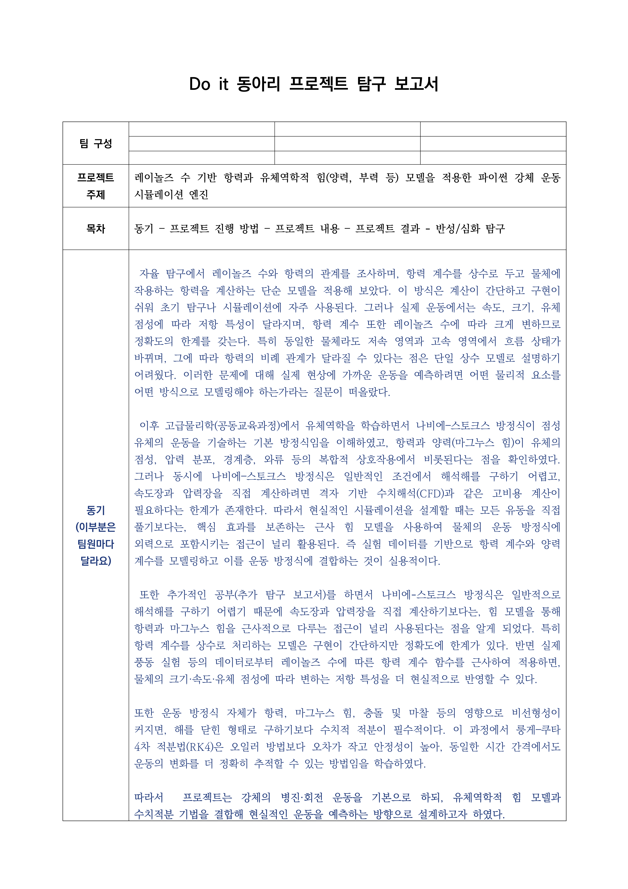

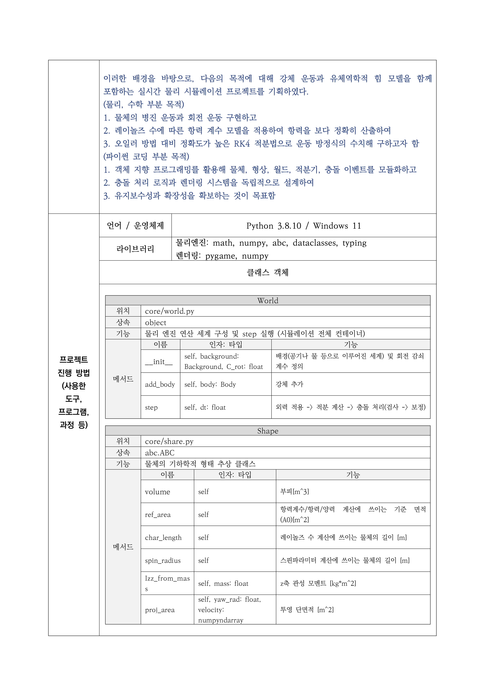

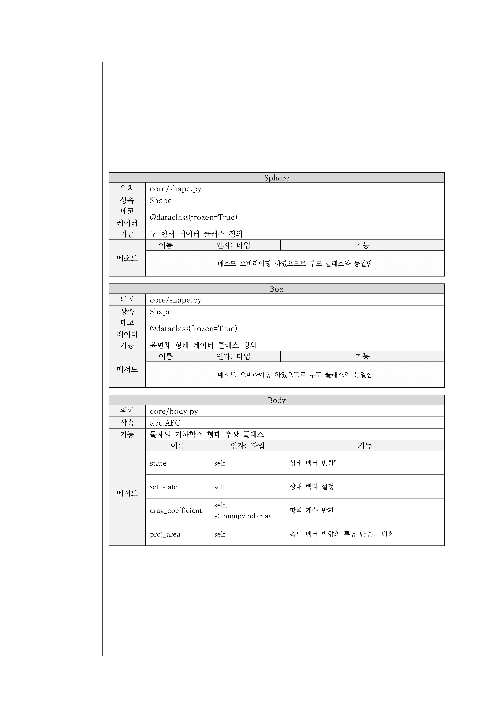

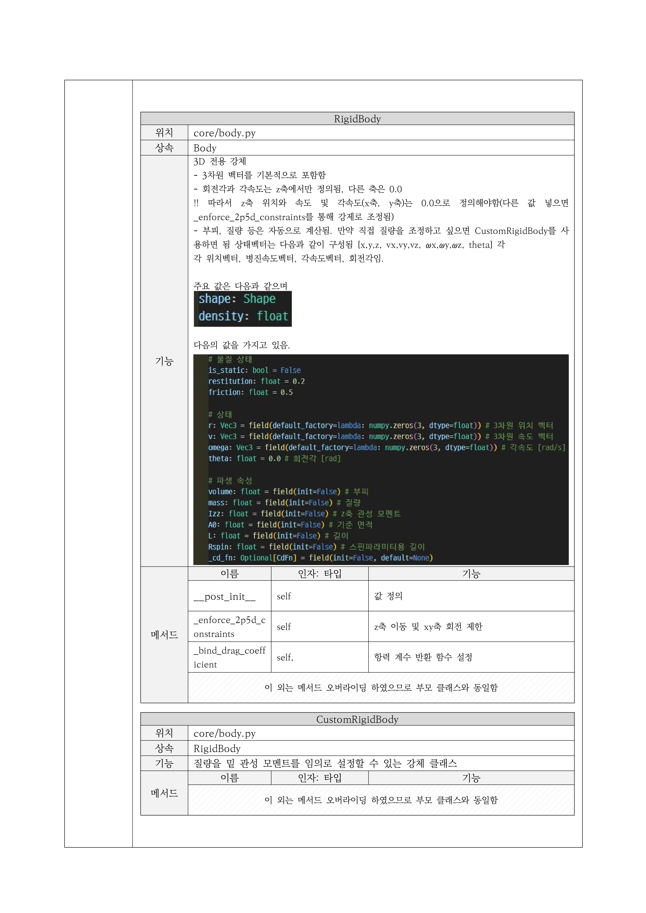

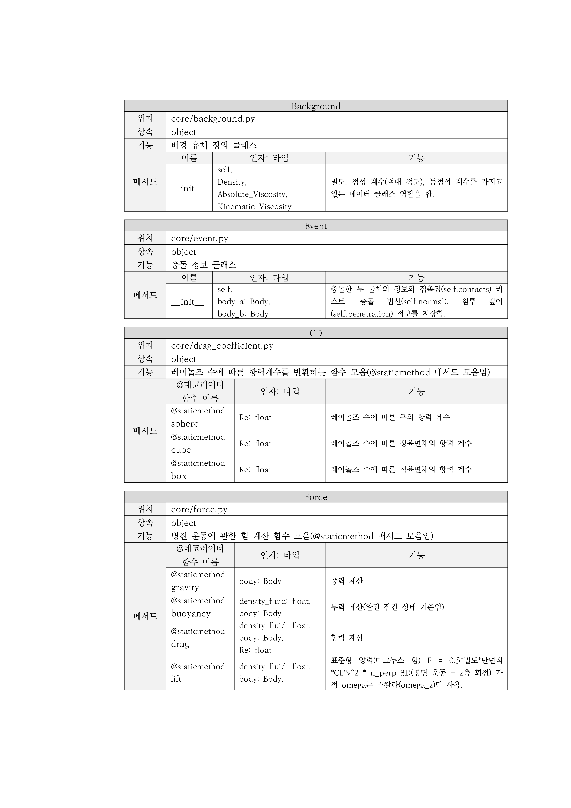

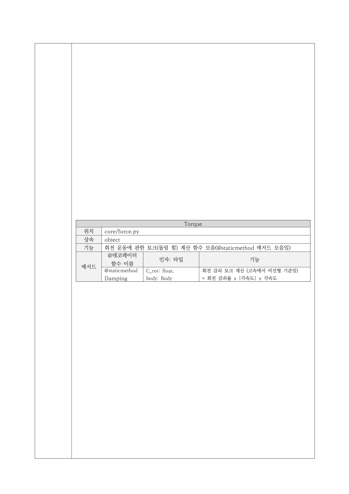

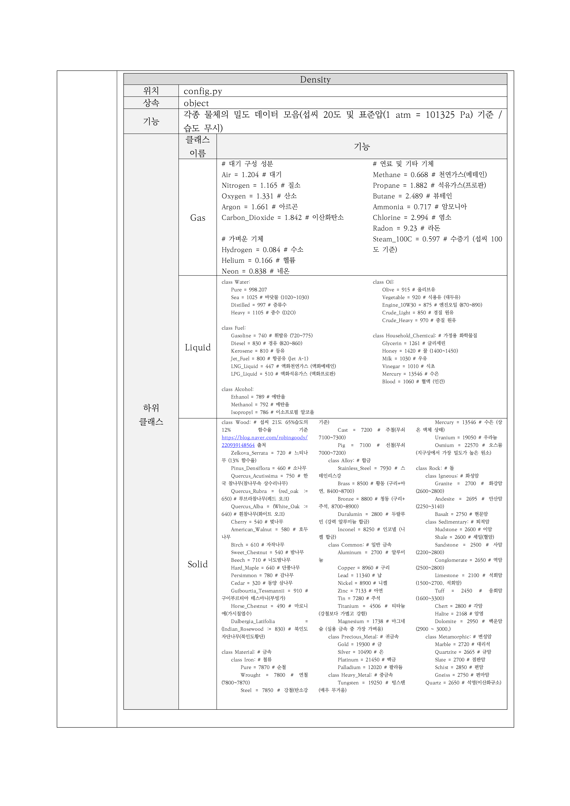

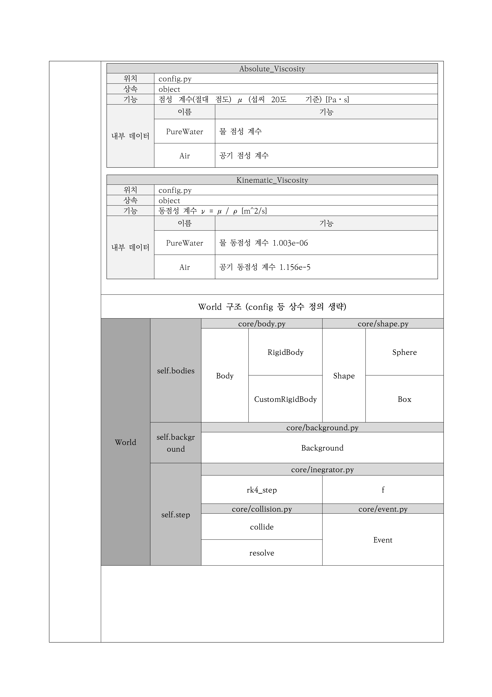

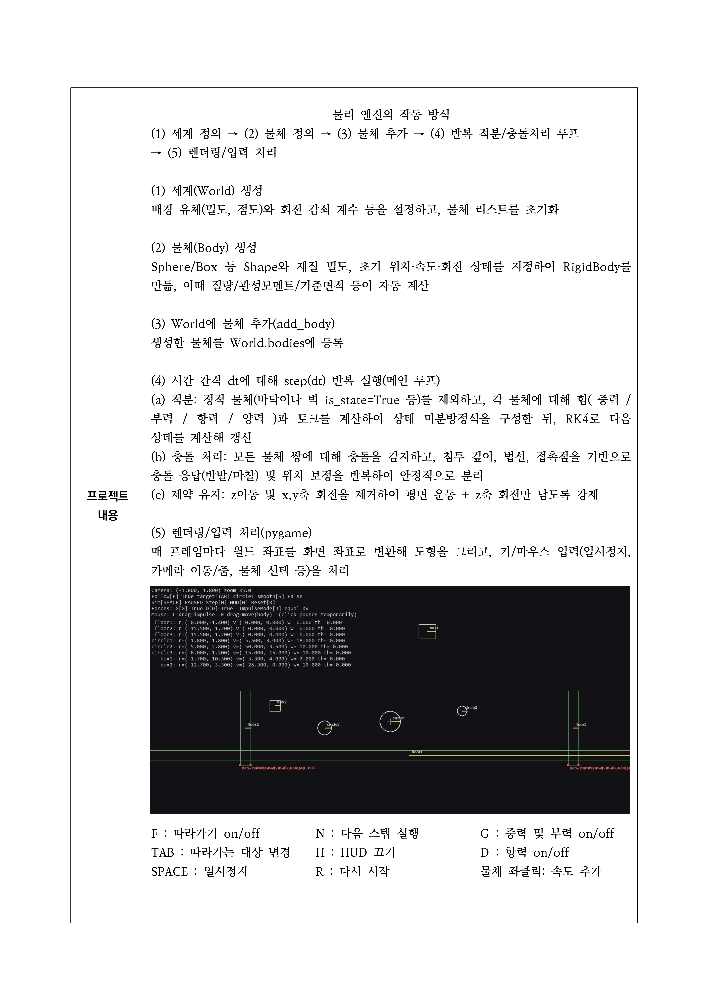

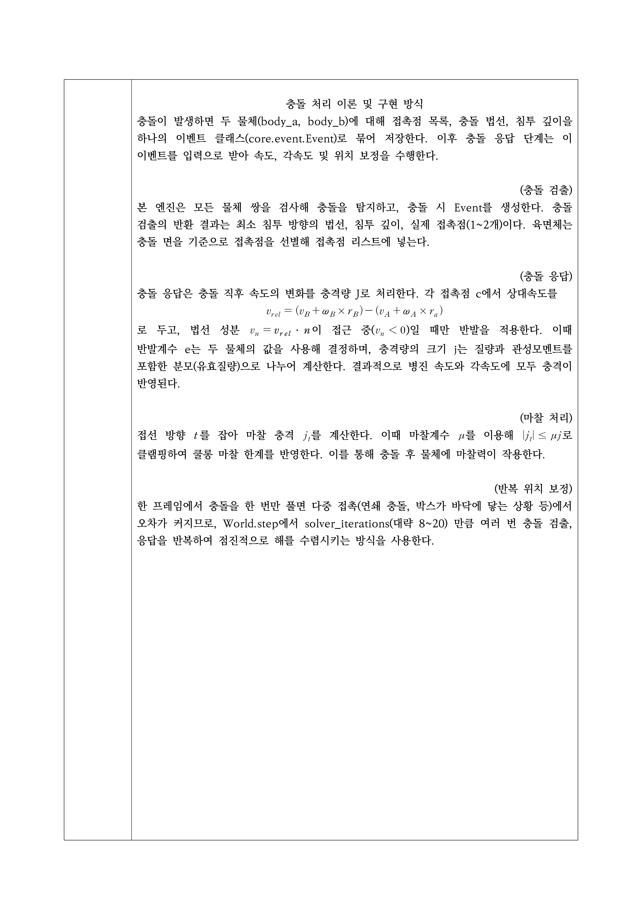

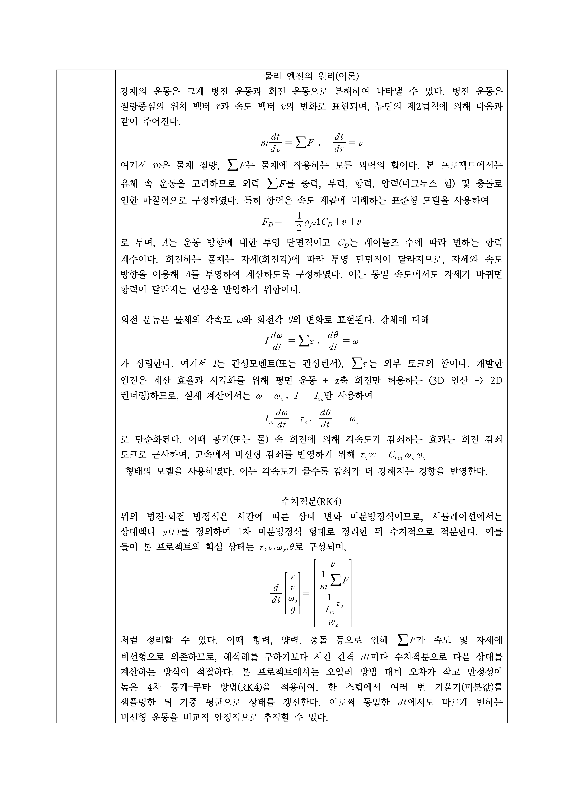

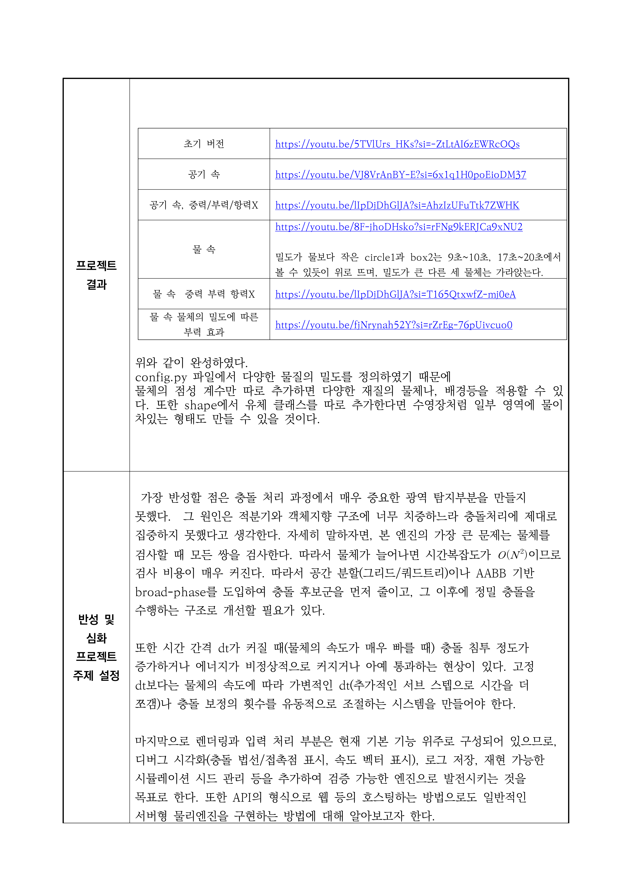

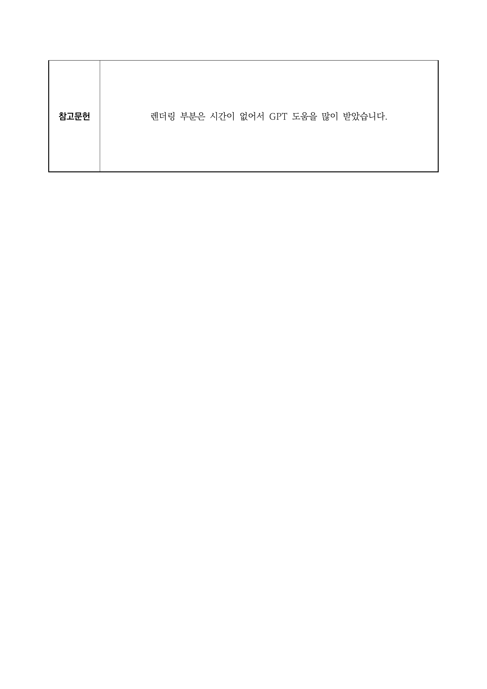
